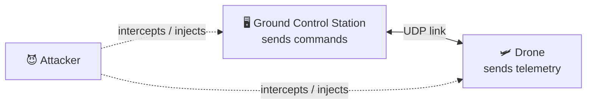

# 🛡️ Secure Telemetry & Command Protocol for UAV / Military Vehicles

> A hands-on computer-security project: **first break it, then defend it.**
> An insecure drone command-and-control protocol is attacked (eavesdropping, replay, injection, MITM), then rebuilt with cryptography (AES-256, HMAC, key exchange, replay protection) so the same attacks fail.


---

## 📌 Overview

Unmanned aerial vehicles (UAVs) and military ground vehicles communicate with a **Ground Control Station (GCS)** over a wireless link. This link carries two kinds of data:

- **Telemetry (downlink):** position, speed, altitude, battery — vehicle → ground
- **Commands (uplink):** "turn left", "climb", "return home" — ground → vehicle

If this channel is unprotected, an attacker can **listen in, inject fake commands, replay old ones, or hijack the vehicle.** This is not theoretical: the widely used **MAVLink** protocol ships, by default, with **no encryption and no authentication**, and GPS/command spoofing of drones has been demonstrated in the real world.

This project models that exact gap in two phases.

## 🎯 The Two-Phase Approach

### 🔴 Phase 1 — Attack (break the insecure protocol)

| Attack | What it does |
|--------|--------------|
| **Eavesdropping** | Captures telemetry/command packets and reads them in plaintext |
| **Replay** | Records a command and re-sends it later to fool the vehicle |
| **Injection / Spoofing** | Injects a forged command the vehicle obeys |
| **Man-in-the-Middle** | Sits between GCS and vehicle and alters commands |
| **Denial of Service** | Floods the command channel so commands can't get through |

### 🟢 Phase 2 — Defense (make the same attacks fail)

| Mechanism | Attack it stops |
|-----------|-----------------|
| **AES-256 encryption** | Eavesdropping |
| **Key exchange (RSA / ECDH)** | Establishes a shared secret safely |
| **HMAC / digital signature** | Injection, MITM, tampering |
| **Nonce + sequence + timestamp** | Replay |
| **Mutual authentication** | Fake GCS / fake vehicle |
| **Anomaly detection (IDS)** | Jamming, abnormal commands |

## 🗺️ Architecture



## 🧰 Tech Stack

- **Language:** Python 3.15
- **Networking:** `socket`, `threading` (standard library)
- **Cryptography:** [`cryptography`](https://cryptography.io) — AES-256, HMAC, ECDH/RSA
- **Visualization:** `matplotlib` (before/after results)
- **Analysis:** Wireshark (packet capture — plaintext vs. encrypted proof)

## 📁 Project Structure

```
iha-guvenlik/
├── README.md
├── .gitignore
├── v1_insecure/        # Phase 2 of roadmap: the vulnerable system
│   ├── drone.py            # sends plaintext telemetry, listens for commands
│   └── gcs.py              # sends commands
├── attacks/            # Phase 3: the exploits
│   └── attacker.py         # eavesdrop / replay / inject
├── v2_secure/          # Phase 4: the hardened system
│   ├── drone_secure.py
│   ├── gcs_secure.py
│   └── crypto_utils.py     # AES + HMAC + key exchange helpers
└── docs/               # diagrams, screenshots, report
```
*(Structure fills in as the project progresses.)*

## 🚀 Getting Started

```bash
# 1. Clone
git clone https://github.com/onurhayta/iha-guvenlik.git
cd iha-guvenlik

# 2. Install dependencies
pip3 install cryptography matplotlib

# 3. Run the insecure demo (two terminals)
python3 v1_insecure/drone.py      # terminal 1
python3 v1_insecure/gcs.py        # terminal 2
```

## 📊 Results

> _Filled in after Phase 5 — a before/after table showing each attack succeeding against v1 and failing against v2, plus matplotlib charts._

## ⚠️ Disclaimer

This project is for **educational purposes only**, built for a university Computer Security course. All attacks run against a local, self-made test system. It must not be used against any real vehicle, network, or system you do not own.

## 👤 Author

**Onur Hayta** — Introduction to Computer Security, Term Project (2026)