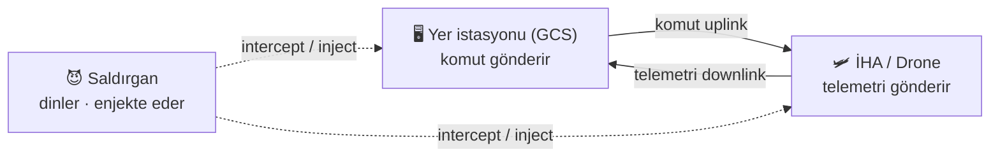

# Aşama 1 — Tehdit Modeli ve Sistem Mimarisi

Bu belge, İHA güvenli telemetri & komuta protokolü projesinin tasarım temelini oluşturur.
Henüz kod yoktur; sistemin mimarisi, tehdit modeli ve paket formatı burada tanımlanır.

---

## 1. Sistem Mimarisi

İHA (Drone) ile Yer Kontrol İstasyonu (GCS — Ground Control Station) kablosuz bir kanal
(UDP) üzerinden iki yönlü haberleşir:

- **Komuta (uplink):** GCS → İHA. Örnek: `TURN_LEFT`, `CLIMB`, `RETURN_HOME`.
- **Telemetri (downlink):** İHA → GCS. Örnek: konum, hız, irtifa, batarya.

Saldırgan, bu kablosuz kanala erişimi olan bir düşmandır ve trafiği dinleyebilir,
değiştirebilir veya sahte paket enjekte edebilir.



---

## 2. Tehdit Modeli

### 2.1. Korunan Varlıklar (Assets)

| Varlık | Neden kritik |
|--------|--------------|
| Komut bütünlüğü | Değiştirilmiş bir komut aracı yanlış yönlendirir |
| Telemetri gizliliği | Konum sızıntısı aracın yerini düşmana verir |
| Uç kimliği | Sahte GCS/İHA sisteme sızabilir |
| Kanal erişilebilirliği | Komut ulaşmazsa araç kontrol edilemez |

### 2.2. Saldırgan Modeli

Saldırganın **yapabildikleri:** kanalı dinleme, paket kaydetme, paket değiştirme,
sahte paket enjekte etme, kanalı boğma (jamming).

Saldırganın **yapamadıkları (güvenlik varsayımı):** AES-256 şifrelemesini kırma,
gizli anahtarı ele geçirme. Projenin tüm güvenliği bu varsayıma dayanır.

### 2.3. STRIDE Tehdit Haritası

| Tehdit (STRIDE) | Projede karşılığı | Saldırı | Savunma |
|---|---|---|---|
| Spoofing | Sahte GCS komut yollar | Injection | Karşılıklı kimlik doğrulama |
| Tampering | Komut havada değiştirilir | MITM | HMAC |
| Information disclosure | Telemetri okunur | Eavesdropping | AES-256 şifreleme |
| Denial of service | Kanal boğulur | Jamming / flood | Anomali tespiti (IDS) |
| Elevation of privilege | Kritik komut enjekte edilir | Replay / Injection | Nonce + sıra no + HMAC |

---

## 3. Paket Formatı Tasarımı

### 3.1. v1 — Güvensiz paket (açık metin)

Hiçbir koruma yok; kanalı dinleyen herkes içeriği okur ve kolayca sahtesini üretir.

```json
{
  "tip": "KOMUT",
  "sira": 42,
  "zaman": 1697449200,
  "veri": "TURN_LEFT"
}
```

### 3.2. v2 — Güvenli paket (şifreli + imzalı)

Gerçek veri AES-256 ile şifrelenir, paket HMAC ile imzalanır, tekrar saldırısına karşı
nonce ve sıra numarası taşınır.

```json
{
  "sira": 42,
  "nonce": "a3f9c1d8...",
  "sifreli": "9b2c7e1f4a...",
  "hmac": "f81a9c3b..."
}
```

| Alan | Görevi | Engellediği saldırı |
|------|--------|---------------------|
| `sifreli` | Veriyi AES-256 ile şifreler | Eavesdropping |
| `hmac` | Paketin parmak izi (değişirse tutmaz) | Tampering, Injection |
| `nonce` | Her pakete özgü rastgele değer | Replay |
| `sira` | Artan sıra numarası | Replay |

### 3.3. Alıcı tarafındaki doğrulama sırası (v2)

1. **HMAC doğrula** — tutmazsa paketi at (sahte veya değiştirilmiş).
2. **Sıra no / nonce kontrol et** — daha önce görülmüşse at (tekrar saldırısı).
3. **Zaman damgasını kontrol et** — çok eskiyse at.
4. **Şifreyi çöz** — yalnızca bu adımlara kadar geçen paket işlenir.

---

## 4. Sonraki Adım

- **Aşama 2:** v1 (güvensiz) protokolü Python ile kodla (`v1_insecure/`).
- **Aşama 3:** Yukarıdaki saldırıları bu güvensiz sisteme karşı uygula (`attacks/`).
- **Aşama 4:** v2 (güvenli) protokolü yukarıdaki paket formatıyla kur (`v2_secure/`).