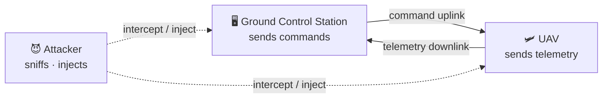

# Phase 1 — Threat Model and System Architecture

This document establishes the design foundation of the Secure UAV Telemetry & Command
Protocol project. No code is written here; it defines the system architecture, the threat
model, and the packet format.

---

## 1. System Architecture

The UAV (unmanned aerial vehicle) and the Ground Control Station (GCS) communicate over a wireless channel
(UDP) in two directions:

- **Command (uplink):** GCS → UAV. Example: `TURN_LEFT`, `CLIMB`, `RETURN_HOME`.
- **Telemetry (downlink):** UAV → GCS. Example: position, speed, altitude, battery.

The attacker is an adversary with access to this wireless channel and can eavesdrop on,
modify, or inject packets.



---

## 2. Threat Model

### 2.1. Protected Assets

| Asset | Why it is critical |
|-------|--------------------|
| Command integrity | A modified command misdirects the vehicle |
| Telemetry confidentiality | A position leak reveals the vehicle to the enemy |
| Endpoint identity | A fake GCS/UAV could infiltrate the system |
| Channel availability | If commands don't arrive, the vehicle can't be controlled |

### 2.2. Attacker Model

What the attacker **can do:** sniff the channel, record packets, modify packets,
inject forged packets, flood the channel (jamming).

What the attacker **cannot do (security assumption):** break AES-256 encryption,
obtain the secret key. The entire security of the project rests on this assumption.

### 2.3. STRIDE Threat Mapping

| Threat (STRIDE) | In this project | Attack | Defense |
|---|---|---|---|
| Spoofing | A fake GCS sends commands | Injection | Mutual authentication |
| Tampering | A command is altered in transit | MITM | HMAC |
| Information disclosure | Telemetry is read | Eavesdropping | AES-256 encryption |
| Denial of service | The channel is flooded | Jamming / flood | Anomaly detection (IDS) |
| Elevation of privilege | A critical command is injected | Replay / Injection | Nonce + sequence no + HMAC |

---

## 3. Packet Format Design

### 3.1. v1 — Insecure packet (plaintext)

No protection at all; anyone sniffing the channel can read the content and easily forge it.

```json
{
  "type": "COMMAND",
  "seq": 42,
  "timestamp": 1697449200,
  "data": "TURN_LEFT"
}
```

### 3.2. v2 — Secure packet (encrypted + signed)

The real data is encrypted with AES-256, the packet is signed with HMAC, and it carries
a nonce and sequence number to defend against replay attacks.

```json
{
  "seq": 42,
  "nonce": "a3f9c1d8...",
  "ciphertext": "9b2c7e1f4a...",
  "hmac": "f81a9c3b..."
}
```

| Field | Purpose | Attack it prevents |
|-------|---------|--------------------|
| `ciphertext` | Encrypts the data with AES-256 | Eavesdropping |
| `hmac` | Fingerprint of the packet (fails if altered) | Tampering, Injection |
| `nonce` | Unique per-packet random value | Replay |
| `seq` | Increasing sequence number | Replay |

### 3.3. Verification order on the receiver side (v2)

1. **Verify HMAC** — if it fails, drop the packet (forged or modified).
2. **Check sequence no / nonce** — if already seen, drop it (replay attack).
3. **Check timestamp** — if too old, drop it.
4. **Decrypt** — only packets that pass all the above steps are processed.

---

## 4. Next Steps

- **Phase 2:** Implement the v1 (insecure) protocol in Python (`v1_insecure/`).
- **Phase 3:** Run the attacks above against this insecure system (`attacks/`).
- **Phase 4:** Build the v2 (secure) protocol with the packet format above (`v2_secure/`).